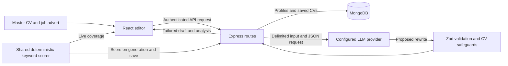

# CV Tailor AI

CV Tailor AI helps you tailor a master CV to a job advert. Paste the advert, generate a draft from your experience, and review the matched and missing keywords as you edit. You can save a version, track the application, and export the CV as PDF or Word.

## Run locally

Use Node.js 24 LTS and npm. The temporary MongoDB used in local development and backend tests downloads a platform binary on first use.

```sh
npm ci
cp .env.example .env
```

On PowerShell use `Copy-Item .env.example .env`. Leave `AI_API_KEY` empty for demo mode, which reorders your existing wording using keyword overlap. Set your provider details to enable AI rewriting. Leave `MONGODB_URI` empty for temporary local storage or set it to keep data between restarts.

Run these in separate terminals.

```sh
npm run dev:server
npm run dev:client
```

Open [the local app](http://localhost:5173). Select owner sign-in and use `APP_PASSWORD` or the local default `dev-password`. Add your CV in **Master CV** by entering your experience or importing a PDF or DOCX. Then open **Tailor**, enter the job title and advert, and select **Tailor My CV**. Open **Match** to see keyword coverage.

## Public signup

Visitors choose **Create account**, enter an email address, and follow the emailed link to set their name and password. Each link can be used once and expires after 30 minutes. Existing accounts continue to sign in with their current credentials.

To enable signup, configure a Resend sending key and a sender address on a verified domain. Set the sender address and key on the server or in the Render service’s environment. Render supplies the public service URL. Set APP_PUBLIC_URL explicitly for local development or a custom domain. Without them, signup is unavailable and existing users can still sign in.

## Environment variables

Copy [.env.example](.env.example) for the full list and sample values. Keep keys and passwords on the server. The frontend uses the same-origin API by default.

| Variable | Purpose |
| --- | --- |
| `AI_API_KEY` | Server-only provider key. An empty value enables demo mode. |
| `AI_BASE_URL`, `AI_MODEL` | Base URL and model for an OpenAI-compatible chat completions provider. |
| `AI_FALLBACK_MODELS` | Comma-separated models. Up to two transient retries use the next distinct model when available. |
| `AI_JSON_MODE`, `AI_TEMPERATURE` | JSON response mode and optional temperature override. |
| `AI_TIMEOUT_MS`, `AI_TOTAL_TIMEOUT_MS` | Provider attempt and overall completion deadlines. Defaults are 30,000 and 90,000 ms. |
| `AI_DAILY_LIMIT`, `AI_DAILY_LIMIT_OWNER` | Daily AI request allowances for members and the owner. Zero allows unlimited requests. |
| `APP_PUBLIC_URL` | Overrides the public origin for verification links. Defaults to the Render service URL on Render. Use `http://localhost:5173` for local Vite. |
| `RESEND_API_KEY`, `SIGNUP_EMAIL_FROM` | Server-only sending key and verified sender address for signup emails. |
| `MONGODB_URI` | Persistent MongoDB connection string. Required in production. |
| `APP_PASSWORD`, `JWT_SECRET` | Owner password and signing secret. Production requires a password of at least 10 characters and a secret of at least 32. |
| `NODE_ENV`, `PORT`, `MAX_UPLOAD_MB` | Runtime mode, server port and maximum upload size. |
| `SERVE_CLIENT`, `CORS_ORIGINS`, `VITE_API_BASE_URL` | Settings for split frontend and API deployments. Only the public API base URL belongs in the client build. |

For a production build, run `npm run build` followed by `npm start`. Express serves the built frontend and API from one origin. The [Render Blueprint](render.yaml) creates one free web service. Enter the database URI, owner password, Resend sending key, and verified sender address in Render. The Blueprint generates the session-signing secret. The app starts in demo mode until an AI provider key is configured in the service environment.

## Architecture



- `client/src/pages` and `client/src/components` contain the form, editor, preview and match panel. `client/src/hooks/useTailoring.ts` owns the tailoring request state.
- `server/src/services/ai` owns prompts, provider transport, response validation and retries. `server/src/services/safeguards.ts` merges the rewrite with candidate facts.
- `server/src/shared` contains the job, resume section and match types, keyword vocabulary, and pure scorer imported by both workspaces.

## How the match score works

1. The scorer looks up whole terms and selected aliases in the job title and advert. It prefers the longer phrase when matches overlap, such as React Native over React.
2. Each distinct term counts once. Required and unqualified terms weigh **3**. Terms in preferred sections or explicitly marked as desirable weigh **1**. If a term is both required and preferred, the higher weight wins.
3. The scorer checks visible CV sections for those terms. It rounds **100 × matched weight ÷ total weight**. Matching a required React keyword and missing preferred Kubernetes yields **75%**.
4. An advert with no recognized terms shows an empty state. An advert with recognized terms and zero matches scores **0%**. Manual edits and layout visibility changes recalculate the score locally. Saving a version recomputes it on the server. Scores on older history cards refresh when those versions are saved again.

The vocabulary covers common terms across several industries. Coverage depends on the vocabulary and aliases. The score does not assess proficiency, years of experience, negation, or how an employer's ATS will rank a CV.

## Truthfulness and privacy

The provider prompt asks the model to rephrase and reorder facts from the master CV and experience the candidate explicitly supplies. The job advert and style samples are treated as untrusted reference data. The server preserves source fields such as employers, titles and dates, filters unsupported skills and figures it can detect, and keeps the candidate's summary when the proposed summary fails those checks. These checks are heuristic, so review rewritten prose before sending it.

The server requests structured JSON, validates the provider envelope and rewrite with Zod, and allows one correction for malformed rewrite content. Transient errors are retried with exponential backoff within the overall deadline. A permanent failure returns a message the form can display without losing the job advert.

Tailoring sends the relevant CV and job text to the configured provider. API credentials stay on the server. Drafts remain in the browser session until saved. Saved CVs and master profiles are scoped to the signed-in account. A share link is public to anyone with its URL until disabled.

## Screenshots

*Placeholder for the tailoring form and the Match tab on desktop and mobile.*

## Checks

```sh
npm run lint
npm run typecheck
npm test
npm run build
```

Vitest covers scoring, JSON parsing, provider errors and backoff behavior, the Express API, and document workflows. The React Testing Library flow covers validation, request locking, error recovery, and live rescoring with a mocked API. Tests do not require an AI key.
